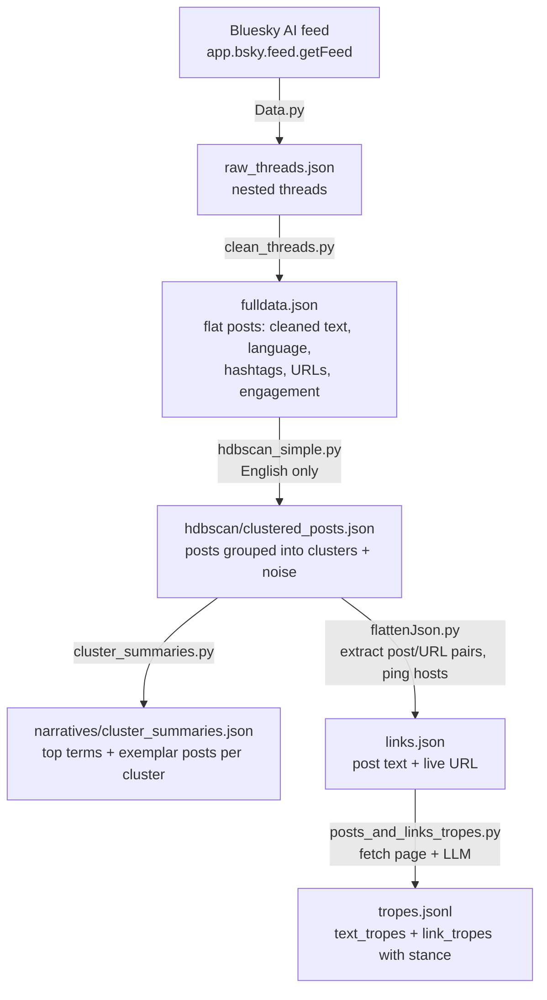

# Bluesky AI Narratives: Collection, Clustering and Trope Extraction

A research pipeline that collects conversations about AI from [Bluesky](https://bsky.app), cleans and flattens them, groups the posts into **narratives** using sentence embeddings and HDBSCAN, and then extracts **tropes** (recurring talking points, with a stance) from both the posts and the web pages they link to, using a large language model.

Everything is plain Python scripts that communicate through JSON files, so every stage can be run, inspected and re-run on its own.

> **The dataset is not included.** The raw and processed data are far too large for a GitHub repository (the working dataset is roughly 37,000 posts, and the intermediate files are tens of megabytes each). You generate it yourself by following [Building the `data/` folder](#building-the-data-folder).

---

## Table of contents

1. [Pipeline overview](#pipeline-overview)
2. [Repository structure](#repository-structure)
3. [Requirements and installation](#requirements-and-installation)
4. [Configuration and credentials](#configuration-and-credentials)
5. [Building the `data/` folder](#building-the-data-folder)
6. [Quick start (all stages)](#quick-start-all-stages)
7. [Stage 1: Data collection (`Data.py`)](#stage-1-data-collection-datapy)
8. [Stage 2: Cleaning and flattening (`clean_threads.py`)](#stage-2-cleaning-and-flattening-clean_threadspy)
9. [Stage 3: Clustering (`hdbscan_simple.py`)](#stage-3-clustering-hdbscan_simplepy)
10. [Stage 4: Cluster summaries (`cluster_summaries.py`)](#stage-4-cluster-summaries-cluster_summariespy)
11. [Stage 5: Trope extraction (`flattenJson.py` and `posts_and_links_tropes.py`)](#stage-5-trope-extraction)
12. [Data schemas](#data-schemas)
13. [Tuning guide](#tuning-guide)
14. [Example results](#example-results)
15. [Known limitations and quirks](#known-limitations-and-quirks)
16. [Troubleshooting](#troubleshooting)
17. [Ethics, privacy and terms of use](#ethics-privacy-and-terms-of-use)
18. [Security checklist before you push](#security-checklist-before-you-push)
19. [Author and license](#author-and-license)

---

## Pipeline overview



| Stage | Script | Input | Output | What it does |
|------:|--------|-------|--------|--------------|
| 1 | `DataHandling/Data.py` | Bluesky login | nested thread JSON | Pulls posts from a Bluesky feed and downloads each full reply thread |
| 2 | `DataHandling/clean_threads.py` | nested thread JSON | flat post JSON | Flattens threads, strips URLs and hashtags, detects language, adds features |
| 3 | `Clustering/hdbscan_simple.py` | flat post JSON | clustered posts JSON | Embeds English posts, reduces with PCA, clusters with HDBSCAN |
| 4 | `Clustering/cluster_summaries.py` | clustered posts JSON | summaries JSON | Computes distinctive terms and exemplar posts per cluster |
| 5a | `Tropes/flattenJson.py` | clustered posts JSON | list of `{text, url}` | Keeps post/URL pairs whose host answers an ICMP ping |
| 5b | `Tropes/posts_and_links_tropes.py` | list of `{text, url}` | JSONL | Extracts tropes and stance from posts and linked articles using an LLM |

---

## Repository structure

```
.
├── README.md
├── code/
│   ├── DataHandling/
│   │   ├── Data.py                    # Stage 1: collect feed + threads from Bluesky
│   │   ├── clean_threads.py           # Stage 2: flatten + clean + enrich
│   │   └── user.env                   # Bluesky credentials (NOT committed, see below)
│   ├── Clustering/
│   │   ├── hdbscan_simple.py          # Stage 3: embeddings + PCA + HDBSCAN
│   │   └── cluster_summaries.py       # Stage 4: c-TF-IDF terms + exemplars
│   ├── narratives/
│   │   └── cluster_summaries.json     # Output of Stage 4 (small enough to commit)
│   └── Tropes/
│       ├── flattenJson.py             # Stage 5a: post/URL pairs, host liveness filter
│       ├── posts_and_links_tropes.py  # Stage 5b: LLM trope extraction
│       ├── plan.txt                   # One-line summary of the trope workflow
│       └── user.env                   # LLM settings / API key (NOT committed)
└── data/                              # You create this (git-ignored), see below
    ├── raw_threads.json
    ├── fulldata.json
    ├── hdbscan/
    │   └── clustered_posts.json
    ├── links.json
    └── tropes.jsonl
```

Each script reads and writes paths relative to the **current working directory** (or paths you pass in), so run the commands from inside the script's own folder as shown in this README.

---

## Requirements and installation

- **Python 3.10 or newer** (the scripts use `X | None` type hints).
- Internet access (Bluesky API, web pages for Stage 5, model download for Stage 3).
- Optional but recommended: a GPU or a fast CPU for Stage 3 embeddings. The default model is small and runs fine on CPU.
- For Stage 5: either an **OpenAI API key** or a local **[Ollama](https://ollama.com)** server (both are used through the OpenAI-compatible client).

### Create a virtual environment

```bash
# from the repository root
python -m venv .venv

# Linux / macOS
source .venv/bin/activate

# Windows (PowerShell)
.venv\Scripts\Activate.ps1
```

### Install dependencies

Install only what you need for the stages you plan to run, or install everything:

```bash
pip install atproto python-dotenv langdetect \
            sentence-transformers hdbscan scikit-learn numpy tqdm \
            requests beautifulsoup4 lxml trafilatura openai icmplib alive-progress
```

| Stage | Packages |
|-------|----------|
| 1. `Data.py` | `atproto`, `python-dotenv` |
| 2. `clean_threads.py` | `langdetect` |
| 3. `hdbscan_simple.py` | `sentence-transformers`, `hdbscan`, `scikit-learn`, `numpy`, `tqdm` |
| 4. `cluster_summaries.py` | `scikit-learn`, `numpy` |
| 5a. `flattenJson.py` | `icmplib`, `alive-progress` |
| 5b. `posts_and_links_tropes.py` | `requests`, `beautifulsoup4`, `lxml`, `trafilatura`, `openai`, `python-dotenv` |

> `langdetect` is imported lazily inside `clean_threads.py`. If it is missing, every post silently gets language `und` and Stage 3 will then find **zero English posts**. Make sure it is installed.

> Tip: once everything works, run `pip freeze > requirements.txt` and commit that file so others can reproduce your exact environment.

---

## Configuration and credentials

Two scripts read a `user.env` file from their working directory using `python-dotenv`. Create them yourself; never commit them.

### `code/DataHandling/user.env` (Stage 1)

```env
BLUESKY_USERNAME=your-handle.bsky.social
BLUESKY_PASSWORD=your-app-password
```

Use a Bluesky **App Password** (Bluesky: *Settings > Privacy and security > App passwords*), not your main account password.

### `code/Tropes/user.env` (Stage 5b)

OpenAI:

```env
OPENAI_API_KEY=sk-...
TROPE_MODEL=gpt-4o-mini
```

Local Ollama (no cloud, no cost):

```env
OPENAI_API_KEY=ollama
OPENAI_BASE_URL=http://localhost:11434/v1
TROPE_MODEL=llama3.2:3b-instruct
```

All supported variables for Stage 5b:

| Variable | Default | Meaning |
|----------|---------|---------|
| `OPENAI_API_KEY` | `ollama` | API key (any non-empty value for Ollama) |
| `OPENAI_BASE_URL` | unset (OpenAI) | Point to any OpenAI-compatible server, e.g. Ollama |
| `TROPE_MODEL` | `llama3.2:3b-instruct` | Model name sent to the server |
| `HTTP_TIMEOUT` | `10` | Seconds to wait when downloading a linked page |
| `MAX_LINK_CHARS` | `1000` | Characters of article text sent to the LLM |
| `MAX_POST_CHARS` | `600` | Characters of post text sent to the LLM (also the "short post" limit for the heuristic) |
| `OLLAMA_NUM_CTX` | `2048` | Context window requested from Ollama (ignored by OpenAI) |
| `OLLAMA_NUM_PREDICT` | `60` | Max output tokens requested from Ollama (ignored by OpenAI) |

---

## Building the `data/` folder

Create the folder at the repository root. It is git-ignored; every file in it is produced by the pipeline.

```bash
mkdir -p data/hdbscan
```

You can reproduce the entire contents by running the [quick start](#quick-start-all-stages). The table below lists what ends up there and how big it tends to be.

| File | Produced by | Typical size (reference run) |
|------|-------------|------------------------------|
| `data/raw_threads.json` | Stage 1 | large (nested threads) |
| `data/fulldata.json` | Stage 2 | ~30 MB, about 36,900 posts |
| `data/hdbscan/clustered_posts.json` | Stage 3 | ~16 MB |
| `data/links.json` | Stage 5a | ~1 MB, about 4,200 post/URL pairs |
| `data/tropes.jsonl` | Stage 5b | depends on the number of pairs |

Because Bluesky content changes over time, **your numbers will differ** from the reference run. Feeds return the newest posts at the time you collect them.

---

## Quick start (all stages)

Run these from the repository root. Adjust the `cd` commands if your layout differs.

```bash
# --- Stage 1: collect (needs code/DataHandling/user.env) ---
cd code/DataHandling
python Data.py                                   # writes clean_ai_threads.json here
mv clean_ai_threads.json ../../data/raw_threads.json

# --- Stage 2: clean + flatten ---
python clean_threads.py ../../data/raw_threads.json ../../data/fulldata.json

# --- Stage 3: embed + cluster ---
cd ../Clustering
python hdbscan_simple.py ../../data/fulldata.json --outdir ../../data/hdbscan

# --- Stage 4: summarise clusters ---
python cluster_summaries.py --input ../../data/hdbscan/clustered_posts.json \
                            --outdir ../narratives --top_k 15 --exemplars 10

# --- Stage 5: tropes (needs code/Tropes/user.env) ---
cd ../Tropes
python flattenJson.py ../../data/hdbscan/clustered_posts.json ../../data/links.json
python posts_and_links_tropes.py --input ../../data/links.json --out ../../data/tropes.jsonl
```

To try Stage 5b on a single item first:

```bash
python posts_and_links_tropes.py --text "This is exactly what regulators need to hear" \
                                 --url "https://example.com/some-article" \
                                 --out single.jsonl
```

---

## Stage 1: Data collection (`Data.py`)

**Purpose:** Download posts from a Bluesky feed generator and then retrieve the full reply thread for every post.

**How it works**

1. `login()` loads `user.env`, reads `BLUESKY_USERNAME` and `BLUESKY_PASSWORD`, and authenticates with the `atproto` client. It raises a clear error if either is missing.
2. `fetch_feed()` pages through `app.bsky.feed.get_feed` using a cursor until `max_posts` is reached or the feed ends. It sleeps 0.2 s between pages.
3. For each feed item, `fetch_thread()` calls `app.bsky.feed.get_post_thread` on the post URI.
4. `simplify_thread()` / `simplify_post()` recursively convert the API objects into plain dictionaries (author handle and display name, text, timestamps, like/repost/quote counts, URLs, and nested `replies`). URLs are collected from legacy link entities **and** from a regex over the post text (full `http(s)://` links, `www.` links and bare domains with common TLDs).
5. `save_threads()` writes the result as UTF-8 JSON and replaces the Unicode line separators U+2028 and U+2029 with spaces so the file is safe to stream line by line.

**Resilience**

- `with_retries()` retries up to 5 times with exponential backoff (1 s base, 20 s cap, plus jitter) on transient failures: HTTP 5xx, timeouts, connection resets and HTTP 429 rate limits. Non-transient errors are raised immediately.
- A checkpoint file (`clean_ai_threads_checkpoint.json`) is written every 1,000 threads so a long run is not lost completely.
- A single failing thread is logged and skipped; it does not abort the run.

**Configuration** (edit `main()` in `Data.py`)

| Setting | Current value | Meaning |
|---------|---------------|---------|
| `feed_uri` | `at://did:plc:y32vdst3y7r4f4pkrveb7jhi/app.bsky.feed.generator/ai` | The Bluesky feed generator to read (the `ai` feed) |
| `max_posts` | `1000` | Number of feed posts to start from |
| `page_size` | `100` | Items per API page |
| `checkpoint_every` | `1000` | Save a checkpoint every N threads |
| output file | `clean_ai_threads.json` | Written to the current directory |

To collect from a different topic, replace `feed_uri` with another feed generator's AT URI. Each feed post expands into its whole thread, so 1,000 starting posts yields many more posts in total.

**Output:** nested thread JSON (see [raw thread schema](#raw-thread-schema)).

---

## Stage 2: Cleaning and flattening (`clean_threads.py`)

**Purpose:** Turn nested threads into one flat list of posts with cleaned text and useful features.

**Usage**

```bash
python clean_threads.py <raw_threads.json> <fulldata.json>
```

**What it does to every post (roots and replies)**

1. **Extracts URLs** from the text with a Unicode-aware regex (`http(s)://` and `www.`), merges them with the URLs already stored by Stage 1, and cleans the list: strips trailing punctuation, drops broken or truncated tokens (shorter than 12 characters, or ending in `://`, `://www.` etc.) and de-duplicates while preserving order.
2. **Removes URLs from the text entirely.**
3. **Extracts hashtags** (Unicode-aware, case-folded, de-duplicated, sorted), removes them from the text and stores them in `Hashtags`.
4. **Normalises whitespace.**
5. **Detects the language** with `langdetect`. A language is only accepted when the top probability is at least **0.80**; otherwise the post is labelled `und` (undetermined). The score is stored in `language_score`.
6. **Adds features:** `char_len`, `word_len`, `has_link`, `url_count`.
7. **Records thread structure:** `post_type` (`root` or `reply`), `depth` (0 for the root), `parent_id`, `root_user_handle` and `in_reply_to_user_handle`.

**Language filtering:** controlled by the module-level constant `KEEP_LANGS`. It is `None` by default, which keeps every post. Set it to e.g. `["en"]` to drop everything else at this stage. (Stage 3 filters to English anyway.)

**Output:** a flat JSON list (see [flat post schema](#flat-post-schema)). It prints the number of posts saved.

---

## Stage 3: Clustering (`hdbscan_simple.py`)

**Purpose:** Group semantically similar English posts into clusters that can be read as candidate *narratives*.

**Usage**

```bash
cd code/Clustering
python hdbscan_simple.py ../../data/fulldata.json --outdir ../../data/hdbscan
```

**Method**

1. **Load** a JSON array (or JSON Lines) of posts and keep only posts that have text and whose `language` is `en` (or `en-*`).
2. **Embed** the text with a `sentence-transformers` model (default `sentence-transformers/all-MiniLM-L6-v2`) in batches, then **L2-normalise** the vectors so that Euclidean distance behaves like cosine distance.
3. **Reduce dimensionality** with PCA (default 50 components, `random_state=0`). This is the biggest speed-up and also helps HDBSCAN on high-dimensional data. Use `--pca 0` to disable.
4. **Cluster** with HDBSCAN (`metric="euclidean"`, `cluster_selection_method="eom"`, approximate minimum spanning tree for speed). `min_samples` is derived as `max(5, min_cluster_size // 2)`.
5. **Write** every post with its `cluster` label (`-1` means noise) and its membership `probability`, plus a run summary.

**Arguments**

| Argument | Default | Meaning |
|----------|---------|---------|
| `input` (positional) | none | JSON array or JSONL with at least `text` and `language` |
| `--outdir` | `hdbscan` | Output directory; the file is `<outdir>/clustered_posts.json` |
| `--model` | `sentence-transformers/all-MiniLM-L6-v2` | Any sentence-transformers model |
| `--batch_size` | `256` | Embedding batch size |
| `--min_cluster_size` | `12` | Smallest group HDBSCAN will call a cluster |
| `--epsilon` | `0.05` | `cluster_selection_epsilon`; merges clusters closer than this distance |
| `--min_samples` | `None` | Parsed but **currently unused** (see [quirks](#known-limitations-and-quirks)) |
| `--pca` | `50` | PCA dimensions before clustering (`0` disables) |
| `--jobs` | CPU count | Parallel jobs for core-distance computation |
| `--quiet` | off | Suppress progress output |

**Output:** `clustered_posts.json` (see [clustered posts schema](#clustered-posts-schema)). The `summary` block records the number of input and English posts, the number of clusters, the **noise ratio**, and the parameters used, so each run documents itself.

---

## Stage 4: Cluster summaries (`cluster_summaries.py`)

**Purpose:** Make each cluster human-readable by computing its most distinctive terms and picking representative posts.

**Usage**

```bash
cd code/Clustering
python cluster_summaries.py --input ../../data/hdbscan/clustered_posts.json \
                            --outdir ../narratives --top_k 15 --exemplars 10
```

**Method**

1. Each cluster (excluding noise, `-1`) is turned into **one long document** by concatenating its cleaned posts. Cleaning removes URLs, keeps word characters, `@`, `#` and apostrophes, and lowercases.
2. A `CountVectorizer` (English stop words, unigrams and bigrams, `min_df=2`, up to 50,000 features) counts terms per cluster-document.
3. A `TfidfTransformer` (L2 norm, smoothed IDF) turns the counts into **class-based TF-IDF** weights, so terms that are frequent in one cluster and rare in the others rank highest.
4. The top `--top_k` terms are kept per cluster.
5. **Exemplar posts** are the top `--exemplars` posts per cluster ranked by cluster-membership probability, then likes, then reposts.

**Arguments**

| Argument | Default | Meaning |
|----------|---------|---------|
| `--input` | `./hdbscan/clustered_posts.json` | Output of Stage 3 |
| `--outdir` | `./narratives` | Where `cluster_summaries.json` is written |
| `--top_k` | `15` | Terms kept per cluster |
| `--exemplars` | `10` | Exemplar posts kept per cluster |

**Output:** `cluster_summaries.json` (see [summary schema](#cluster-summary-schema)). This file is small (a few hundred KB), so it is reasonable to commit.

---

## Stage 5: Trope extraction

This stage identifies **tropes**: short labels (2 to 7 words) for recurring talking points, each with a stance (`pro`, `anti`, `neutral`, `unclear`). It looks at both the **post text** and the **content of the page the post links to**. The workflow summarised in `plan.txt` is:

> dataset, keep only posts with links and flatten, drop invalid links, run `posts_and_links_tropes.py`

### 5a. `flattenJson.py`: build the post/URL list

```bash
python flattenJson.py ../../data/hdbscan/clustered_posts.json ../../data/links.json
```

1. Walks **every cluster in the Stage 3 output, including the noise group `-1`**, and collects each `(post text, URL)` pair.
2. Extracts the hostname of each URL (adding `http://` if the scheme is missing).
3. Sends an **ICMP ping** (2 packets, 1 s timeout, unprivileged mode via `icmplib`) and keeps the pair only if the host answers. Results are cached per host, so each host is pinged once.
4. De-duplicates on (normalised text, normalised URL) and writes a JSON list of `{ "text": ..., "url": ... }`.
5. Prints how many URLs were scanned, how many hosts were up or down, and how many unique items were written.

A live progress bar (`alive-progress`) shows each host as it is checked.

> **Platform note:** unprivileged ICMP needs OS support. On Linux you may need `sudo sysctl -w net.ipv4.ping_group_range="0 2147483647"` (or run with elevated rights). Windows and macOS generally work without changes.

### 5b. `posts_and_links_tropes.py`: extract tropes

```bash
python posts_and_links_tropes.py --input ../../data/links.json --out ../../data/tropes.jsonl
```

For every item the script does the following:

1. **Fetch and extract the linked page.** Downloads the URL (browser-like User-Agent, redirects followed, `HTTP_TIMEOUT` seconds). It extracts the main article text with `trafilatura`; if that yields fewer than 40 words it falls back to a `BeautifulSoup` text dump with scripts, navigation, headers, footers, forms and asides removed. The text is truncated to `MAX_LINK_CHARS`.
2. **Try a fast heuristic on the post.** If the post is short (at most `MAX_POST_CHARS` characters) and contains positive or negative emoji or keywords (for example "agree", "based", "exactly", "wrong", "nonsense"), it is labelled **"agrees with link"** or **"disagrees with link"** with no LLM call.
3. **Otherwise ask the LLM** (in parallel, up to 6 worker threads) to return JSON with at most **two** tropes for the post text, and for the article text, each with a `label` and `stance`. The prompt requests JSON only, temperature is 0.05, and Ollama-specific options (context size, max tokens, stop sequences) are passed through `extra_body` and ignored by OpenAI.
4. **Sanitise the model output.** Labels that are empty, placeholders ("trope", "short concrete trope", "example trope"...) or shorter than 2 or longer than 9 words are dropped. Unknown stances become `unclear`. Labels are capped at 120 characters. If the model returns extra text around the JSON, the first `{...}` block is extracted.

**Arguments**

| Argument | Meaning |
|----------|---------|
| `--input` | JSON list of `{"text": ..., "url": ...}` (output of 5a) |
| `--out` | Output JSONL path (required) |
| `--text`, `--url` | Analyse a single post and/or link instead of a file |

**Output format:** one JSON object per line, **in the same order as the input list**. The record does not repeat the input text or URL, so line *n* of the output corresponds to item *n* of `links.json`.

```json
{"text_tropes": [{"label": "AI regulation is lagging behind", "stance": "pro"}],
 "link_tropes": [{"label": "tech companies self-regulate poorly", "stance": "neutral"}]}
```

(That record is an illustration of the format, not real output from the dataset.)

**Cost and speed:** items are processed one after another; within an item up to two LLM calls run in parallel. With ~4,000 items that is up to ~8,000 calls. A small local model through Ollama is free but slower and lower quality; `gpt-4o-mini` is cheap and quick. Test with `--text`/`--url` or a slice of `links.json` first.

---

## Data schemas

### Raw thread schema

Output of Stage 1 (a list of these):

```json
{
  "thread_id": "3l...",
  "root_user": {"handle": "someone.bsky.social", "display_name": "Someone"},
  "root_text": "post text...",
  "urls": ["https://..."],
  "started_at": "2025-09-01T12:34:56.000Z",
  "likes": 12, "reposts": 3, "quotes": 1,
  "replies": [
    {
      "post_id": "3l...",
      "user": {"handle": "...", "display_name": "..."},
      "text": "...", "created_at": "...",
      "likes": 0, "reposts": 0, "quotes": 0,
      "urls": [],
      "replies": [ ]
    }
  ]
}
```

### Flat post schema

Output of Stage 2 (one object per root post or reply):

| Field | Type | Description |
|-------|------|-------------|
| `post_id` | string | Post record key |
| `thread_id` | string | Id of the root post of its thread |
| `post_type` | string | `root` or `reply` |
| `depth` | int | 0 for the root, 1 for direct replies, and so on |
| `user_handle`, `user_name` | string | Author handle and display name |
| `root_user_handle` | string | Author of the thread's root post |
| `in_reply_to_user_handle` | string or null | Author of the parent post |
| `parent_id` | string or null | Parent post id (null for roots) |
| `text` | string | Cleaned text: URLs and hashtags removed, whitespace normalised |
| `language`, `language_score` | string, float | Detected language (or `und`) and its probability |
| `created_at` | string | ISO timestamp |
| `likes`, `reposts`, `quotes` | int | Engagement counts at collection time |
| `urls` | list of string | Cleaned, de-duplicated URLs |
| `has_link`, `url_count` | bool, int | Link features |
| `char_len`, `word_len` | int | Length of the cleaned text |
| `Hashtags` | list of string | Case-folded hashtags without `#` |

### Clustered posts schema

Output of Stage 3:

```json
{
  "summary": {
    "n_input_posts": 36879, "n_english": 28700, "n_clusters": 88,
    "noise_ratio": 0.88, "min_cluster_size": 12,
    "model": "sentence-transformers/all-MiniLM-L6-v2",
    "pca_dims": 50, "epsilon": 0.05
  },
  "clusters": {
    "-1": [ { "post_id": "...", "thread_id": "...", "user_handle": "...", "text": "...",
              "language": "en", "likes": 0, "reposts": 0, "quotes": 0, "urls": [],
              "created_at": "...", "cluster": -1, "probability": 0.0 } ],
    "0":  [ ... ],
    "1":  [ ... ]
  }
}
```

Cluster `-1` holds the **noise** posts that HDBSCAN did not assign to any cluster.

### Cluster summary schema

Output of Stage 4:

```json
{
  "source": "/absolute/path/to/clustered_posts.json",
  "summary": { "...": "copied from Stage 3" },
  "noise": {"posts": 26188},
  "clusters": {
    "0": {
      "size": 16,
      "top_terms": [["copyright", 0.31], ["eu", 0.27]],
      "exemplars": [
        {"post_id": "...", "thread_id": "...", "user_handle": "...",
         "probability": 1.0, "likes": 5, "reposts": 1, "quotes": 0, "text": "..."}
      ]
    }
  }
}
```

### Links file and trope output

- `links.json`: `[{"text": "<post text>", "url": "<url>"}, ...]`
- `tropes.jsonl`: one `{"text_tropes": [...], "link_tropes": [...]}` object per line, aligned with `links.json`.

---

## Tuning guide

| Goal | What to change |
|------|----------------|
| Fewer, broader clusters | Increase `--min_cluster_size` (e.g. 25 to 50) and/or `--epsilon` |
| More, finer-grained clusters | Decrease `--min_cluster_size` (e.g. 8) and keep `--epsilon` at 0 |
| Lower noise ratio | Decrease `--min_cluster_size`; try `--pca 20` to `30`; try a stronger embedding model via `--model` |
| Faster clustering | Keep PCA on; raise `--batch_size` if you have a GPU; use the default small model |
| Better embeddings | Try a larger model such as `sentence-transformers/all-mpnet-base-v2` (slower) |
| Multilingual analysis | Set a multilingual `--model` and relax the English filter in `hdbscan_simple.py` (`is_english`) |
| More descriptive summaries | Increase `--top_k`; consider lowering `min_df` in `cluster_summaries.py` (see quirks) |
| Cheaper trope extraction | Use `gpt-4o-mini` or a local Ollama model; reduce `MAX_LINK_CHARS` |
| Richer trope extraction | Increase `MAX_LINK_CHARS` and `MAX_POST_CHARS`; allow more than 2 tropes (`max_items` in `clean_tropes` and the prompt) |

---

## Example results

Numbers from development runs on one collection of about **36,900 posts** (yours will differ):

| Run | Settings | English posts | Clusters | Noise |
|-----|----------|--------------:|---------:|------:|
| A | `min_cluster_size=15`, `epsilon=0.0` | 29,104 | 56 | ~90.0% |
| B (current defaults) | `min_cluster_size=12`, `epsilon=0.05` | 28,700 | 88 | ~88.3% |

Stage 5a reduced the post/URL pairs to about **4,200 unique items** after the host liveness check and de-duplication.

Typical cluster outputs in `narratives/cluster_summaries.json` look like a list of distinctive terms plus exemplar posts, for example a cluster whose top terms are about EU copyright and AI regulation, another about interviews and Anthropic, and so on. Several clusters are dominated by **repeated or automated posts** (aggregator accounts, cross-posted articles, spam), which is a useful finding in itself.

---

## Known limitations and quirks

These are documented honestly so that results are interpreted correctly.

**Clustering**

- **High noise ratio.** Roughly 88 to 90% of English posts end up as noise. Short, informal posts embed poorly into dense regions. The clusters are the *dense* parts of the conversation, not a full partition of it.
- **`--min_samples` is ignored.** The argument is parsed, but the clusterer always uses `max(5, min_cluster_size // 2)`.
- **Duplicates form clusters.** Near-identical posts (bots, aggregators, spam) produce tight clusters. Inspect or de-duplicate before drawing conclusions about "narratives".
- The usage comment at the top of the file mentions `hdbscan_simple_fast.py`; the script is called `hdbscan_simple.py`.

**Cluster summaries**

- `min_df=2` is applied across **cluster documents**, so a term must appear in at least two clusters to be kept. Words unique to a single cluster are dropped, even though they would be the most distinctive. Set `min_df=1` if you want them.
- The weighting is a class-level TF-IDF (similar in spirit to BERTopic's c-TF-IDF but using the standard smoothed IDF).

**Data collection and cleaning**

- The feed URI and `max_posts` are hard-coded in `Data.py` (`main()`).
- Engagement counts (likes, reposts, quotes) are a snapshot at collection time.
- `clean_threads.py` deletes URLs from the text (the `URL_PLACEHOLDER` constant is currently unused). The URLs are preserved in the `urls` field.
- Language detection on very short posts is unreliable, so many are labelled `und` and excluded from clustering.

**Trope extraction**

- **ICMP ping is only a rough liveness test.** Many healthy servers block ping (false negatives), and a live host can still return a 404 or a paywall (false positives). It checks hosts, not individual URLs.
- Ping is run for **all** clusters, including noise, so the link set is not restricted to clustered posts.
- The agree/disagree heuristic is intentionally crude. It matches common words (for example "no", "great", "nice") and, because patterns are compiled case-insensitively, single letters such as "W" or "L" can match too. Positive signals are checked before negative ones. Heuristic results have an empty `stance` string.
- Only the first `MAX_LINK_CHARS` (1,000 by default) of an article and `MAX_POST_CHARS` (600) of a post reach the LLM, so tropes reflect the beginning of the content.
- LLM output is not deterministic, and small local models may produce weaker labels or occasionally malformed JSON (such items return an empty list).
- Trope labels are free text; there is no canonical taxonomy, so similar tropes will appear under different wording. A follow-up normalisation or clustering step is recommended before counting them.

---

## Troubleshooting

| Symptom | Likely cause and fix |
|---------|----------------------|
| `Login failed. Check user.env...` | `user.env` missing, in the wrong folder, or variable names wrong. Run `Data.py` from inside `code/DataHandling/`. |
| Stage 3 prints `english: 0` and writes empty clusters | `langdetect` was not installed when running Stage 2, so everything is `und`. Install it and re-run Stage 2. |
| `ModuleNotFoundError: hdbscan` or build errors | Install build tools (a C compiler) or use a prebuilt wheel; make sure you installed `hdbscan`, not just scikit-learn. |
| Stage 3 is very slow | Use a smaller model, keep PCA enabled, run on a GPU, or test on a slice of the data. |
| `PermissionError` or all hosts "down" in `flattenJson.py` | Unprivileged ICMP is disabled (Linux sysctl, see note above) or a firewall blocks ping. |
| Stage 5b returns empty `link_tropes` | Page blocked bots, timed out, or had too little text. Try a larger `HTTP_TIMEOUT`. |
| `401`/`404` from the OpenAI client | Wrong `OPENAI_API_KEY`, or `TROPE_MODEL` not available on the server behind `OPENAI_BASE_URL`. For Ollama run `ollama pull llama3.2:3b-instruct` first. |
| Bluesky `429` / rate-limit messages | Handled by the retry logic; if persistent, lower the pace or retry later. |

---

## Ethics, privacy and terms of use

- The dataset contains **public posts from real people**, including handles and display names. Do not publish the raw dataset, do not attempt to identify or contact individuals, and follow the terms of service of Bluesky and of any site you fetch in Stage 5.
- Prefer reporting **aggregate results** (clusters, term lists, trope counts). If you quote posts, consider paraphrasing or anonymising them.
- Respect rate limits and `robots.txt`-style expectations when scraping linked pages; the Stage 5b fetcher is intentionally simple and low-volume.
- Clusters can contain offensive, spam or adult content. Review exemplars before sharing summaries.
- LLM-generated tropes and stances are **automatic annotations**, not ground truth. Validate on a manually labelled sample before relying on them.

---

## Security checklist before you push

The `user.env` files hold **secrets**. Make sure they never reach GitHub.

Create a `.gitignore` at the repository root:

```gitignore
# secrets
user.env
*.env

# data (too large and contains user content)
data/

# python environments and caches
.venv/
venv/
__pycache__/
*.pyc

# large intermediate/result files
code/Clustering/fulldata.json
code/Clustering/clustered_posts.json
code/Clustering/hdbscan/
code/Tropes/clustered_posts.json
code/Tropes/test.json
```

Then:

1. Remove anything already tracked: `git rm -r --cached code/**/user.env code/Tropes/.venv` (adjust paths).
2. **If a key or password was ever committed or shared, treat it as compromised:** revoke the OpenAI key, delete the Bluesky app password and create new ones. Deleting the file in a later commit does not remove it from Git history.
3. Optionally commit `user.env.example` files with placeholder values so others know which variables to set.
4. Check file sizes: GitHub rejects files over 100 MB and warns above 50 MB.

---

## Author and license

**Author:** Roger Wan Bengini

**License:** *Add a `LICENSE` file (for example MIT) and state it here.*

**Citing:** *If this code supports a paper or thesis, add the citation here.*
